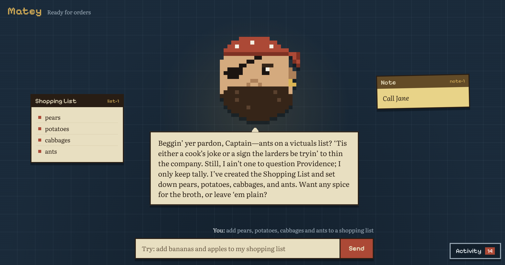

# Matey

**An agentic home assistant with the soul of a golden-age pirate.**

Matey is a demo of an Alexa-style assistant built with the OpenAI Agents SDK. Type a request like *"add bananas and apples to my shopping list"* or *"I called Jane back, so get rid of that note"*. An agent works out what you meant, opens and edits windows on screen, and replies through Matey, a pixel-art pirate who has opinions about your groceries.

It's a proof of concept for agent behaviour: planning, tool use, several actions per request, and live visibility into what the agent is doing.



## Key features

- **Agent-driven windows.** Matey creates, updates and closes lists and sticky notes, and keeps track of what's already on screen so you never get two shopping lists.
- **Several actions in one request.** "Called Jane back, add pears" adds the pears *and* removes the Jane note, with a reply for each.
- **Replying is a tool.** The agent decides when to speak, so it can give progress updates mid-task.
- **Persona kept separate.** A planning agent does the work in plain language. A separate voice agent turns each message into Matey's pirate speech.
- **Live activity panel.** A collapsible feed with an unread badge shows every agent step and tool call as it happens.
- **Animated pixel pirate.** He bobs while idle, ponders while working and talks when replying.
- **Full tracing.** Every request appears as one trace in the OpenAI Traces dashboard.
- **Draggable windows** that spawn in free space around the screen.

## Tech stack

- Python, [OpenAI Agents SDK](https://github.com/openai/openai-agents-python), FastAPI, Uvicorn
- WebSockets for live updates
- Vanilla HTML, CSS and JavaScript (no build step), with the pirate drawn as SVG pixel art
- Docker and Docker Compose
- pytest, using the SDK's scripted fake models (no API key needed)

## Quick start

You need Docker with the Compose plugin and an OpenAI API key.

1. Clone the repo:
   ```bash
   git clone https://github.com/oliver-j-carr/matey.git && cd matey
   ```
2. Create your settings file:
   ```bash
   cp .env.example .env
   ```
3. Edit `.env` and set `OPENAI_API_KEY`.
4. Build and start:
   ```bash
   docker compose up -d --build
   ```
5. Open <http://127.0.0.1:8090> and give Matey an order.

To run the tests: `python3 -m venv .venv && . .venv/bin/activate && pip install -r requirements-dev.txt && pytest -q`

## Environment variables

| Variable | Required | Purpose |
|---|---|---|
| `OPENAI_API_KEY` | Yes | Calls the models and uploads traces |
| `BRAIN_MODEL` | No | Model for the planning agent that uses tools |
| `VOICE_MODEL` | No | Model that writes Matey's replies (a small, fast model works well) |
| `BRAIN_REASONING_EFFORT` | No | Optional reasoning effort for the brain, e.g. `low` |
| `VOICE_REASONING_EFFORT` | No | Optional reasoning effort for the voice |
| `MAX_TURNS` | No | Safety cap on model calls per request |
| `TRACE_WORKFLOW_NAME` | No | Name shown for each request in OpenAI Traces |
| `OPENAI_AGENTS_DISABLE_TRACING` | No | Set to `true` to stop sending traces to OpenAI |

See `.env.example` for defaults.

## Roadmap

- **Voice input:** push-to-talk speech-to-text, so requests are spoken and then answered.
- **Spoken replies:** a pirate text-to-speech voice, with the mouth synced to the audio. 
- **More window types,** such as timers and weather.
- **Persistence,** so windows survive a restart.
- **User editing,** such as ticking off items and closing windows by hand.